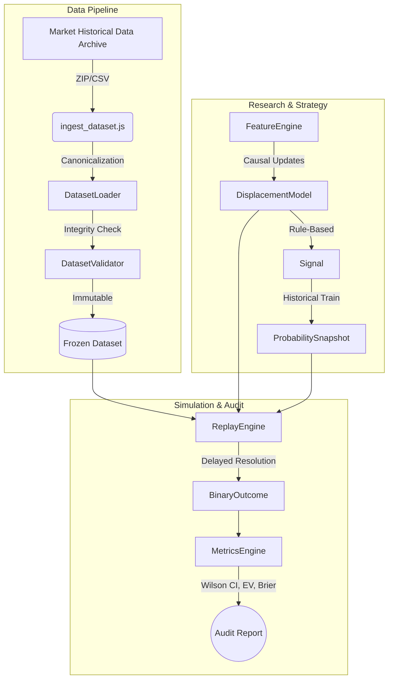

# Time-Series Quantitative Backtesting & Statistical Simulation Engine


Sistema quantitativo institucional e rigorosamente estruturado para pesquisa estatística, auditoria causal e backtesting de modelos preditivos em séries temporais financeiras e derivativos de liquidação discreta.

Este repositório é um laboratório de evidências empíricas projetado para **testar rigorosamente a presença ou ausência de edge estatístico e econômico** sob premissas estritas de causalidade.

---

## 🏛️ Filosofia e Epistemologia (O Contrato Quantitativo)

O projeto opera sob um contrato estrito de integridade de dados e causalidade:

1. **Strict Causality (No Look-ahead):** O estado OOS (*Out-of-Sample*) é atualizado de forma estritamente sequencial. O timestamp $t+1$ nunca influencia a decisão em $t$.
2. **Barreira Econômica (Break-Even):** Para um payout de 0.80, a barreira não é 50%. A barreira é $P_{BE} = 55.56\%$. Qualquer modelo com *win rate* inferior a isso possui *Negative Expectancy (EV < 0)*, independentemente de p-values de edge direcional.
3. **Imutabilidade e Congelamento (FROZEN):** Hipóteses são pré-declaradas em formato estruturado e **congeladas** em controle de versão antes de qualquer dado OOS ser consumido, eliminando o risco de *post-hoc tuning* (overfitting).
4. **Intervalos de Confiança de Wilson:** O motor de métricas utiliza o intervalo de confiança de Wilson (95%) em vez de aproximações normais de Wald, lidando de maneira robusta com proporções extremas e amostras pequenas ($N_{min} = 30$).

---

## 🏗️ Arquitetura do Sistema

O laboratório é dividido em pipelines desacoplados, garantindo que o carregamento de dados não contamine a modelagem e que o motor de replay opere de forma agnóstica.



---

## 📂 Estrutura Modular

```text
.
├── research/
│   ├── datasets/            # Datasets canônicos e manifestos com hashes SHA-256
│   ├── hypotheses/          # Hipóteses pré-declaradas e congeladas (ex: HYPOTHESIS_001.md)
│   └── reports/             # Relatórios JSON de OOS Walk-Forward
├── scripts/                 # Scripts de ingestão, replay e baseline OOS
├── src/
│   ├── core/                # Primitivas imutáveis (Signal, MarketObservation, BinaryOutcome)
│   ├── data/                # Validadores estruturais e loaders estritos
│   ├── replay/              # Motor causal de replay (Delayed Resolution)
│   ├── research/            # Motores de calibração, métricas e baselines
│   ├── strategy/            # Feature Engine e Classificadores
│   └── validation/          # Walk-Forward rolling validators
└── tests/                   # 100+ testes unitários e adversariais em Jest
```

---

## 🔬 Estado de Validação

- **Baseline Real Market:** Análise de regime de mercado em dados históricos de alta frequência executada.
- **Validação Adversarial:** 100 testes automatizados cobrindo invariantes causais, ausência de look-ahead bias e estresse numérico.
- **Datasets Canônicos:** Ingestão de séries de tick/candle com zero gaps temporais validadas via checksums.
- **Short-Horizon Displacement:** Hipóteses probabilísticas testadas sob critérios estritos de significância.

---

## 🚀 Execução Local & Testes

### Pré-requisitos
- Node.js (v18+)
- Git

### Instalação
```bash
git clone https://github.com/jonatanciamarro/binary-options-quant.git
cd binary-options-quant
npm install
```

### Rodando a Suíte de Testes Adversariais (100+ Testes)
```bash
npx jest
```
*(Todos os 100+ testes cobrindo integridade de dados, controle negativo, calibração matemática e estresse temporal são executados).*

---

## ⚖️ Licença e Aviso Legal

Distribuído sob a licença MIT. 
Este software destina-se estritamente à pesquisa quantitativa e simulação acadêmica de séries temporais.
